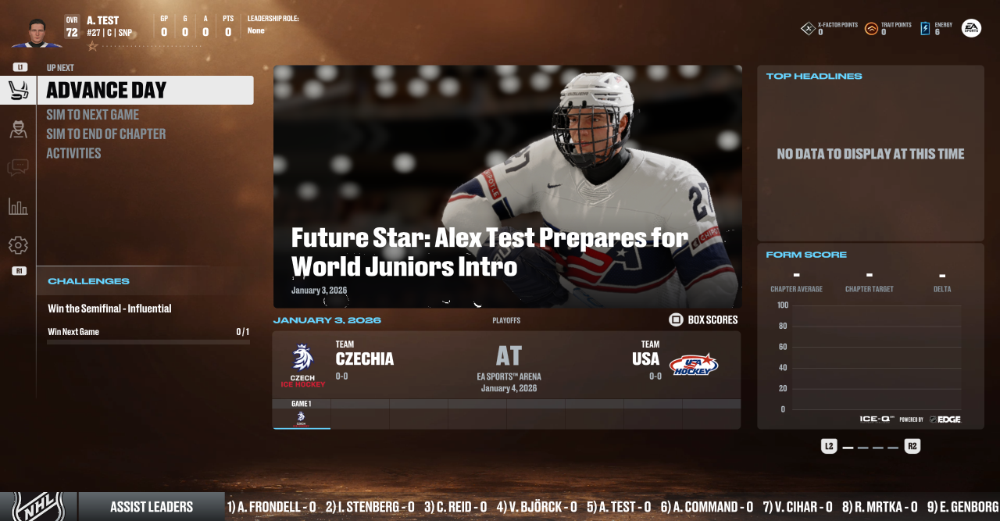

# 🏒 KytyPS5 NHL 27 Enhanced

### **NHL 27** on a Windows PC, on the KytyPS5 emulator.
*60 fps in play on a fast PC, and Be a Pro menus and pictures that finally work.*

[**⬇ Download the latest version**](https://github.com/MatusRiedl/KytyPS5-nhl27-enhanced/releases/latest)
&nbsp;·&nbsp; [Get started](#-get-started) &nbsp;·&nbsp; [Known issues](#-known-issues) &nbsp;·&nbsp; [Full notes](docs/nhl27-enhanced.md)

Questions, news and help: **[gg.puckpeak.com](https://gg.puckpeak.com)**

> [!IMPORTANT]
> This is a test build, tested on one PC. Expect fps drops and the odd crash. It's a fork of
> [duy64/KytyPS5-nhl](https://github.com/duy64/KytyPS5-nhl) and holds **no game files**: you need your own dump of the game.

## ✨ Highlights

- 🛠 **Be a Pro crash fixed.** Opening Weekly Growth or Traits crashed the game every time. 5 of 5 opens crashed before the fix, 0 of 13 after it.
- 🖼 **Be a Pro pictures fixed.** The hub headline picture and the player, agent, coach and GM portraits no longer come out as coloured noise.
- 🎯 **Steady pace.** Menus hold 30 fps and play holds 60 fps, the way the game asks for them, instead of running uncapped.
- ⚡ **A faster build.** Built with PGO and AVX2. Play 1% lows rose from about 46 to about 49 fps, and frames over 50 ms in a match fell from about 30 to about 15.
- 🖱 **One double-click to start.** `Play-NHL27.cmd` applies all the NHL 27 settings for you and remembers your game folder.
- 📦 **Everything in one zip.** No separate emulator or launcher to install.

## 🚀 Get started

1. Download `KytyPS5-nhl27-enhanced-rc3.zip` (11 MB) from the release page.
2. Extract it anywhere you can write to, with at least 2 GB free. Not inside `Program Files`.
3. Double-click `Play-NHL27.cmd`.
4. Pick your game folder, the one that holds `eboot.bin`. It's remembered in `game_path.txt`: delete that file to pick another folder.
5. Keep the black window open while you play. Close the game window when you're done.

Don't start `kyty_emulator.exe` directly: it would run without the NHL 27 settings.

To keep saves from another Kyty install, copy `_SaveData`, `_DownloadData` and `_Trophies` into this folder.

**First start:** shaders compile while you play, so the first arena load stutters for 30 s or longer. That happens once per folder. New modes can hitch the first time too. If your profile shows "Sign in required", press OK.

## What you need

| | |
|---|---|
| System | Windows 10 or 11, 64-bit |
| Game | Your own dump of NHL 27 (PPSA34063). Tested with version 01.003.001 |
| CPU | AVX2 required (Intel Haswell / AMD Zen or newer). Without it the game won't start |
| Memory | About 14 GB of free RAM |
| GPU | About 10 GB of video memory at 2560x1440, with a current driver |
| Runtime | The latest [Microsoft Visual C++ Redistributable (x64)](https://aka.ms/vs/17/release/vc_redist.x64.exe), if a window names `MSVCP140.dll` or `VCRUNTIME140.dll` |

Tested only on a Ryzen 7 9800X3D, an RTX 5080 with driver 621.01 and 32 GB of RAM. Expect lower numbers on slower hardware. Other GPUs have not been tried.

## 🐞 Known issues

- **Sudden fps drops.** Roughly 1 match in 4 in scripted tests drops to 5-10 fps, for a few seconds up to more than a minute. There are at least two causes and neither is fixed.
- **Crash when simming between shifts.** A tester on NVIDIA reports a crash in Be a Pro when 2 or more goals are scored during a sim to the next shift, on an earlier build. It could not be reproduced here: 5 sims ran clean, but none had 2 or more goals, so it may still be there.
- **Rare crashes.** One GPU device loss happened in a test build during this work, cause unknown.
- **Long sessions.** The longest test was 55 minutes. Three matches in a row, saving and reloading a career, and a full Be a Pro season have not been tested.
- **Stutter.** Entering play can stall for 70-220 ms, and heavy 30 fps cut-scenes can dip to 20-25 fps for a few seconds.
- **Starting again right after closing** can fail with `could not reserve 13824 MB for guest direct memory`. Wait a few seconds and try again.
- **ONES mode** needs readback on, according to upstream: add `--readback-linear-images true` to `extra_args` in `cfgGlobal.json`. Not tested with this build.
- **Online modes**, PSN and EA servers don't work, and that's not a goal of this project.
- The upstream bugs (jersey cloth, some skin tones, facial hair, bright pixels, logos) are unchanged.

**Hit a problem?** Open an [issue](https://github.com/MatusRiedl/KytyPS5-nhl27-enhanced/issues) or ask on [Discord](https://gg.puckpeak.com). Tell us the scene, your GPU and your driver version. After a crash or freeze keep `play_log.txt`: the next start moves it to `play_log_previous.txt`, and the start after that replaces it.

<b>Settings and controls</b>

### Display

Open `cfgGlobal.json` in a text editor.
| Setting | Values |
|---|---|
| `screen_resolution` | `R1280X720`, `R1920X1080`, `R2560X1440` (default), `R3840X2160` |
| `fullscreen_enabled` | `true` or `false` (default) |

Fullscreen ran fine at 2560x1440 in one short session. Other resolutions are untested.

### Controls

Plug in a controller before you start. On the keyboard:

| Keys | PS5 button |
|---|---|
| J / L / I / K | Cross / Circle / Triangle / Square |
| Arrow keys | D-pad |
| WASD | Left stick |
| Enter | Options |
| Q / E | L1 / R1 |

### Disk space

The folder grows to about 1 GB after the first run. The shader cache in `_PipelineCache` takes 100-150 MB, and `_TempData` is the game's own scratch data, about 850 MB. Copy `_PipelineCache` along if you move to a new folder, or the shaders compile again.

<b>What changed</b>

## What changed

Changes made on top of [duy64/KytyPS5-nhl](https://github.com/duy64/KytyPS5-nhl) release `a917829`, up to 2026-11-02:

- **Be a Pro crash:** a depth target reused at the same address with a wider width kept the old, narrower image. It's rebuilt now. This was not an NVIDIA driver bug.
- **Be a Pro images:** the game reads those pictures from memory right after the GPU draws them, and the emulator now copies them back in time. `KYTY_READBACK_STILLS=0` turns this off.
- **Pacing:** the game's own flip rate at a 60 Hz vblank is the default. `KYTY_FORCE_FLIP_RATE=0` with `KYTY_MENU_VBLANK_HZ=240` / `KYTY_PLAY_VBLANK_HZ=240` brings back the old behaviour.
- **Late flips:** at the 30 Hz flip rate, a frame that misses its vblank shows on the next vblank (50 ms) instead of the next even one (66 ms). `KYTY_LATE_FLIP=0` restores the old behaviour.
- **Build:** PGO and AVX2, with clang-cl 19.1.5 from VS 2022 Build Tools. Build line: [tools/pgo/README.md](tools/pgo/README.md).
- **Logging:** `NHL27FRAMETIME` every 5 s, `NHL27HITCH` for each frame from 40 ms.
- **Scripted input:** text and overlay keys, used for automated tests.
- **Start script and settings:** [tools/nhl27](tools/nhl27).

Full notes: [docs/nhl27-enhanced.md](docs/nhl27-enhanced.md).

<b>Measured</b>

## Measured

Ryzen 7 9800X3D, RTX 5080, scripted 15-minute CPU vs CPU Play Now match.

| | a917829 defaults (1 run) | Pacing fix (2 runs) | Pacing fix + PGO/AVX2 (3 runs) |
|---|---|---|---|
| Play fps (median / p10) | 67 / 54 (uncapped) | 60 / 59-60 | 60 / 60 |
| Play mean 1% low (fps) | - | 44.9-46.9 | 48.7-49.8 |
| Play 5 s windows with no missed frame | - | 58-71% | 75-87% |
| Play frames over 50 ms (15 min) | - | 28-31 | 9-23 |
| Menus / 30 Hz scenes fps (median / p10) | 40 / - (uncapped) | 30 / 29 | 30 / 28 |

These numbers are from RC2. The RC3 fixes were not measured separately. On the RC3 code, a 55-minute Be a Pro run (two games) had no crash, with play at a median of 60 fps and a 1% low of 52.

## Running from source

The code of each release is on the release page and on the branch `nhl27-enhanced`. Build steps: [the upstream README](docs/README-upstream.md#building) and [tools/pgo/README.md](tools/pgo/README.md).

## Credits and legal

Built for the NHL community, by [Puck Peak](https://www.puckpeak.com).

Standing on the work of duy64 ([KytyPS5-nhl](https://github.com/duy64/KytyPS5-nhl)), pengui07, pargi, the [KytyPS5](https://github.com/KytyPS5/KytyPS5) authors and the original [Kyty](https://github.com/InoriRus/Kyty). AnyPS5 (boykopovar) was used as a reference only. No code was copied from it. The credits from upstream are in [docs/README-upstream.md](docs/README-upstream.md#credits).

The changes, measurements and notes were produced with an AI coding assistant (Claude) driving the build, scripted test runs and log analysis. The Be a Pro crash and the image bug were found by hand.

### Disclaimer

This is an unofficial fan project. It is not affiliated with, endorsed by or sponsored by Sony Interactive Entertainment, PlayStation, Electronic Arts, EA SPORTS, the NHL or the NHLPA. All trademarks belong to their owners. No game files, firmware or system software are in this repository or its releases. Use only game files you have obtained legally. No money is made from this project.

### License

[GPL-2.0](LICENSE), like KytyPS5. Licenses of the bundled parts are in [LICENSES](LICENSES) and in the `licenses` folder of the release.
